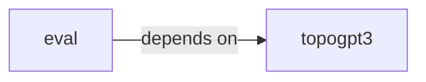

# eval

eval groups 11 files (py) around load_humaneval, build_prompt, extract_candidate, run_one_test, run_one_test_sandboxed. Streaming + governance for autoregressive generation.

## eval (2.1)

eval groups 9 files (py) around load_humaneval, build_prompt, extract_candidate, run_one_test, run_one_test_sandboxed. Streaming + governance for autoregressive generation.

## topogpt3 (2.2)

topogpt3 groups 2 files (py) around ScalePreset, InferenceSettings, scale_presets, preset, validate. TopoGPT3: complex-valued spectral language model for code.

**Files**:

- eval/governor.py
- eval/governor_smoke.py
- eval/harness.py
- eval/integration_smoke.py
- eval/noise_sweep.py
- eval/repair.py
- eval/samplers.py
- eval/smoke.py
- eval/temp_sweep.py
- topogpt3/__init__.py
- topogpt3/inference.py
