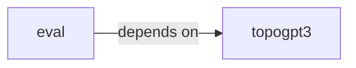

# eval

eval groups 13 files (py) around YaRNConfig, yarn_scale_inv_freq, apply_yarn_to_rope, SandboxConfig, _names_imported. Streaming + governance for autoregressive generation.

## eval (2.1)

eval groups 11 files (py) around SandboxConfig, _names_imported, _blocked_dunder_access, _max_depth, d. Streaming + governance for autoregressive generation.

## topogpt3 (2.2)

topogpt3 groups 2 files (py) around YaRNConfig, yarn_scale_inv_freq, apply_yarn_to_rope. TopoGPT3: complex-valued spectral language model for code.

**Files**:

- eval/governor.py
- eval/governor_smoke.py
- eval/harness.py
- eval/integration_smoke.py
- eval/noise_sweep.py
- eval/repair.py
- eval/samplers.py
- eval/sandbox.py
- eval/sandbox_smoke.py
- eval/smoke.py
- eval/temp_sweep.py
- topogpt3/__init__.py
- topogpt3/yarn.py
