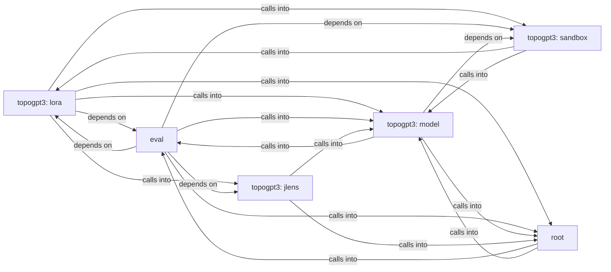

## Details

Static architecture map of 53 files (c, py, sh) in 6 components: topogpt3: lora, eval, topogpt3: model, topogpt3: sandbox, topogpt3: jlens, root. Structure is extracted statically without LLM calls; component prose may be enriched locally.

### topogpt3: lora (1)

topogpt3: lora groups 12 files (py) around Logger, is_main_process, get_lr, setup_seed, init_distributed_mode. main: TopoGPT3 entry point.

**Related Classes/Methods**:

- <a href="../topogpt3/trainer_utils_topo.py#L20-L24">topogpt3/trainer_utils_topo.py::Logger</a>
- <a href="../topogpt3/trainer_utils_topo.py#L25-L28">topogpt3/trainer_utils_topo.py::is_main_process</a>
- <a href="../topogpt3/trainer_utils_topo.py#L29-L33">topogpt3/trainer_utils_topo.py::get_lr</a>
- <a href="../topogpt3/trainer_utils_topo.py#L34-L42">topogpt3/trainer_utils_topo.py::setup_seed</a>
- <a href="../topogpt3/trainer_utils_topo.py#L43-L51">topogpt3/trainer_utils_topo.py::init_distributed_mode</a>
- <a href="../topogpt3/trainer_utils_topo.py">topogpt3/trainer_utils_topo.py::SkipBatchSampler</a>
- <a href="../topogpt3/trainer_utils_topo.py#L53-L57">topogpt3/trainer_utils_topo.py::__init__</a>
- <a href="../topogpt3/trainer_utils_topo.py#L58-L71">topogpt3/trainer_utils_topo.py::__iter__</a>

### eval (2)

eval groups 11 files (py) around load_humaneval, build_prompt, extract_candidate, run_one_test, run_one_test_sandboxed. Streaming + governance for autoregressive generation.

**Related Classes/Methods**:

- <a href="../eval/harness.py#L59-L74">eval/harness.py::load_humaneval</a>
- <a href="../eval/harness.py#L75-L99">eval/harness.py::build_prompt</a>
- <a href="../eval/harness.py#L100-L149">eval/harness.py::extract_candidate</a>
- <a href="../eval/harness.py#L150-L171">eval/harness.py::run_one_test</a>
- <a href="../eval/harness.py#L172-L194">eval/harness.py::run_one_test_sandboxed</a>
- <a href="../eval/harness.py#L195-L203">eval/harness.py::make_sampler</a>
- <a href="../eval/harness.py#L204-L216">eval/harness.py::completion_for_problem</a>
- <a href="../eval/harness.py#L217-L219">eval/harness.py::ModelLoader</a>

### topogpt3: model (3)

topogpt3: model groups 8 files (py) around TopoGPT2Config, __post_init__, setup_logger, set_seed, QuaternionOps. Diagnostico estatico de un checkpoint TopoGPT3 congelado.

**Related Classes/Methods**:

- <a href="../topogpt3/model.py#L56-L160">topogpt3/model.py::TopoGPT2Config</a>
- <a href="../topogpt3/model.py#L161-L191">topogpt3/model.py::__post_init__</a>
- <a href="../topogpt3/model.py#L192-L201">topogpt3/model.py::setup_logger</a>
- <a href="../topogpt3/model.py#L202-L213">topogpt3/model.py::set_seed</a>
- <a href="../topogpt3/model.py#L214-L221">topogpt3/model.py::QuaternionOps</a>
- <a href="../topogpt3/model.py#L222-L233">topogpt3/model.py::hamilton_product</a>
- <a href="../topogpt3/model.py#L234-L237">topogpt3/model.py::normalize</a>
- <a href="../topogpt3/model.py#L238-L242">topogpt3/model.py::conjugate</a>

### topogpt3: sandbox (4)

topogpt3: sandbox groups 7 files (py) around YaRNConfig, yarn_scale_inv_freq, apply_yarn_to_rope, pre_processing_chat, post_processing_chat. Sandbox for executing model-generated code during HumanEval evaluation.

**Related Classes/Methods**:

- <a href="../topogpt3/yarn.py#L18-L25">topogpt3/yarn.py::YaRNConfig</a>
- <a href="../topogpt3/yarn.py#L26-L49">topogpt3/yarn.py::yarn_scale_inv_freq</a>
- <a href="../topogpt3/yarn.py#L50-L62">topogpt3/yarn.py::apply_yarn_to_rope</a>
- <a href="../topogpt3/chat.py#L43-L53">topogpt3/chat.py::pre_processing_chat</a>
- <a href="../topogpt3/chat.py#L54-L59">topogpt3/chat.py::post_processing_chat</a>
- <a href="../topogpt3/chat.py#L60-L70">topogpt3/chat.py::_fmt_tool_defs</a>
- <a href="../topogpt3/chat.py#L71-L115">topogpt3/chat.py::apply_chat_template</a>
- <a href="../topogpt3/chat.py#L116-L125">topogpt3/chat.py::parse_tool_calls</a>

### topogpt3: jlens (5)

topogpt3: jlens groups 4 files (py) around LensModel, encode, forward, unembed, TopoGPT3LensConfig. TestValidPositionMask: Feature: valid_position_mask excludes attention-sink and final...

**Related Classes/Methods**:

- <a href="../topogpt3/lens_model.py#L23-L39">topogpt3/lens_model.py::LensModel</a>
- <a href="../topogpt3/lens_model.py#L40-L44">topogpt3/lens_model.py::encode</a>
- <a href="../topogpt3/lens_model.py#L45-L51">topogpt3/lens_model.py::forward</a>
- <a href="../topogpt3/lens_model.py#L52-L58">topogpt3/lens_model.py::unembed</a>
- <a href="../topogpt3/lens_model.py#L59-L83">topogpt3/lens_model.py::TopoGPT3LensConfig</a>
- <a href="../topogpt3/lens_model.py#L84-L103">topogpt3/lens_model.py::from_topogpt2_config</a>
- <a href="../topogpt3/lens_model.py#L104-L141">topogpt3/lens_model.py::probe_checkpoint</a>
- <a href="../topogpt3/lens_model.py#L142-L149">topogpt3/lens_model.py::_TopoGPT3ResidualForward</a>

### root (6)

root groups 3 files (c, py) around FILE, stdin, stdout, stderr, printf. Drop-in entry point that demonstrates how to use the topogpt3 package.

**Related Classes/Methods**:

- <a href="../topogpt3.c">topogpt3.c::FILE</a>
- <a href="../topogpt3.c">topogpt3.c::stdin</a>
- <a href="../topogpt3.c">topogpt3.c::stdout</a>
- <a href="../topogpt3.c">topogpt3.c::stderr</a>
- <a href="../topogpt3.c">topogpt3.c::printf</a>
- <a href="../topogpt3.c">topogpt3.c::fprintf</a>
- <a href="../topogpt3.c">topogpt3.c::sprintf</a>
- <a href="../topogpt3.c">topogpt3.c::snprintf</a>
