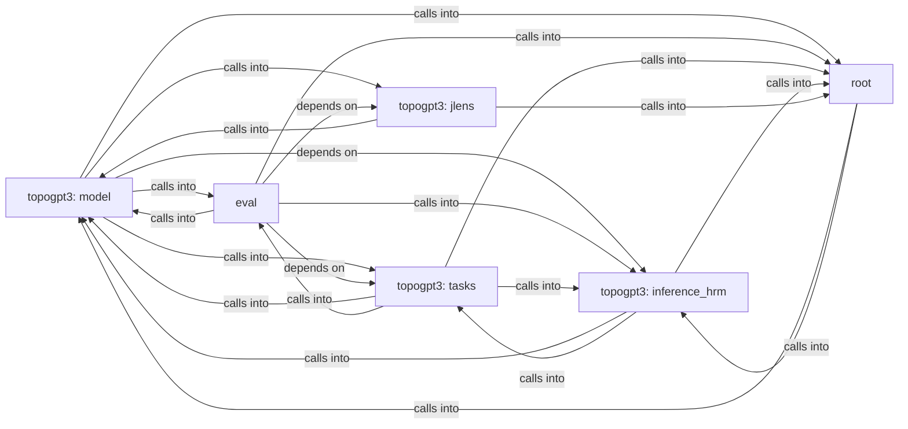

## Details

Static architecture map of 64 files (c, py, sh) in 6 components: topogpt3: model, eval, topogpt3: tasks, topogpt3: inference_hrm, topogpt3: jlens, root. Structure is extracted statically without LLM calls; component prose may be enriched locally.

### topogpt3: model (1)

topogpt3: model groups 15 files (py) around TopoGPT2Config, __post_init__, setup_logger, set_seed, QuaternionOps. Diagnostico estatico de un checkpoint TopoGPT3 congelado.

**Related Classes/Methods**:

- <a href="../topogpt3/model.py#L59-L169">topogpt3/model.py::TopoGPT2Config</a>
- <a href="../topogpt3/model.py#L170-L255">topogpt3/model.py::__post_init__</a>
- <a href="../topogpt3/model.py#L256-L267">topogpt3/model.py::setup_logger</a>
- <a href="../topogpt3/model.py#L268-L280">topogpt3/model.py::set_seed</a>
- <a href="../topogpt3/model.py#L281-L288">topogpt3/model.py::QuaternionOps</a>
- <a href="../topogpt3/model.py#L289-L303">topogpt3/model.py::hamilton_product</a>
- <a href="../topogpt3/model.py#L304-L307">topogpt3/model.py::normalize</a>
- <a href="../topogpt3/model.py#L308-L312">topogpt3/model.py::conjugate</a>

### eval (2)

eval groups 13 files (py) around YaRNConfig, yarn_scale_inv_freq, apply_yarn_to_rope, SandboxConfig, _names_imported. Streaming + governance for autoregressive generation.

**Related Classes/Methods**:

- <a href="../topogpt3/yarn.py#L18-L25">topogpt3/yarn.py::YaRNConfig</a>
- <a href="../topogpt3/yarn.py#L26-L49">topogpt3/yarn.py::yarn_scale_inv_freq</a>
- <a href="../topogpt3/yarn.py#L50-L62">topogpt3/yarn.py::apply_yarn_to_rope</a>
- <a href="../eval/sandbox.py#L53-L99">eval/sandbox.py::SandboxConfig</a>
- <a href="../eval/sandbox.py#L100-L113">eval/sandbox.py::_names_imported</a>
- <a href="../eval/sandbox.py#L114-L122">eval/sandbox.py::_blocked_dunder_access</a>
- <a href="../eval/sandbox.py#L123-L124">eval/sandbox.py::_max_depth</a>
- <a href="../eval/sandbox.py#L125-L132">eval/sandbox.py::d</a>

### topogpt3: tasks (3)

topogpt3: tasks groups 10 files (py) around pre_processing_chat, post_processing_chat, _fmt_tool_defs, _tool_calls_text, apply_chat_template. Generic task eval: JSONL cases + safe verifiers.

**Related Classes/Methods**:

- <a href="../topogpt3/chat.py#L43-L53">topogpt3/chat.py::pre_processing_chat</a>
- <a href="../topogpt3/chat.py#L54-L59">topogpt3/chat.py::post_processing_chat</a>
- <a href="../topogpt3/chat.py#L60-L84">topogpt3/chat.py::_fmt_tool_defs</a>
- <a href="../topogpt3/chat.py#L85-L111">topogpt3/chat.py::_tool_calls_text</a>
- <a href="../topogpt3/chat.py#L112-L159">topogpt3/chat.py::apply_chat_template</a>
- <a href="../topogpt3/chat.py#L160-L169">topogpt3/chat.py::parse_tool_calls</a>
- <a href="../topogpt3/chat.py#L170-L177">topogpt3/chat.py::parse_thinking</a>
- <a href="../topogpt3/chat.py#L178-L186">topogpt3/chat.py::split_reasoning_content</a>

### topogpt3: inference_hrm (4)

topogpt3: inference_hrm groups 9 files (py) around read_state, probe_checkpoint, config_from_checkpoint, state_summary, config_dict. Checkpoint architecture discovery tests.

**Related Classes/Methods**:

- <a href="../topogpt3/checkpoint_meta.py#L24-L34">topogpt3/checkpoint_meta.py::read_state</a>
- <a href="../topogpt3/checkpoint_meta.py#L35-L80">topogpt3/checkpoint_meta.py::probe_checkpoint</a>
- <a href="../topogpt3/checkpoint_meta.py#L81-L119">topogpt3/checkpoint_meta.py::config_from_checkpoint</a>
- <a href="../topogpt3/checkpoint_meta.py#L120-L128">topogpt3/checkpoint_meta.py::state_summary</a>
- <a href="../topogpt3/checkpoint_meta.py#L129-L130">topogpt3/checkpoint_meta.py::config_dict</a>
- <a href="../topogpt3/continuation.py#L25-L35">topogpt3/continuation.py::_count_unclosed_brackets</a>
- <a href="../topogpt3/continuation.py#L36-L44">topogpt3/continuation.py::_count_unclosed_fences</a>
- <a href="../topogpt3/continuation.py#L45-L74">topogpt3/continuation.py::is_response_complete</a>

### topogpt3: jlens (5)

topogpt3: jlens groups 4 files (py) around LensModel, encode, forward, unembed, TopoGPT3LensConfig. TestValidPositionMask: Feature: valid_position_mask excludes attention-sink and final...

**Related Classes/Methods**:

- <a href="../topogpt3/lens_model.py#L23-L39">topogpt3/lens_model.py::LensModel</a>
- <a href="../topogpt3/lens_model.py#L40-L44">topogpt3/lens_model.py::encode</a>
- <a href="../topogpt3/lens_model.py#L45-L51">topogpt3/lens_model.py::forward</a>
- <a href="../topogpt3/lens_model.py#L52-L58">topogpt3/lens_model.py::unembed</a>
- <a href="../topogpt3/lens_model.py#L59-L83">topogpt3/lens_model.py::TopoGPT3LensConfig</a>
- <a href="../topogpt3/lens_model.py#L84-L103">topogpt3/lens_model.py::from_topogpt2_config</a>
- <a href="../topogpt3/lens_model.py#L104-L141">topogpt3/lens_model.py::probe_checkpoint</a>
- <a href="../topogpt3/lens_model.py#L142-L149">topogpt3/lens_model.py::_TopoGPT3ResidualForward</a>

### root (6)

root groups 3 files (c, py) around FILE, stdin, stdout, stderr, printf. Drop-in entry point that demonstrates how to use the topogpt3 package.

**Related Classes/Methods**:

- <a href="../topogpt3.c">topogpt3.c::FILE</a>
- <a href="../topogpt3.c">topogpt3.c::stdin</a>
- <a href="../topogpt3.c">topogpt3.c::stdout</a>
- <a href="../topogpt3.c">topogpt3.c::stderr</a>
- <a href="../topogpt3.c">topogpt3.c::printf</a>
- <a href="../topogpt3.c">topogpt3.c::fprintf</a>
- <a href="../topogpt3.c">topogpt3.c::sprintf</a>
- <a href="../topogpt3.c">topogpt3.c::snprintf</a>
