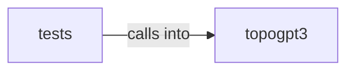

# topogpt3: inference_hrm

topogpt3: inference_hrm groups 9 files (py) around read_state, probe_checkpoint, config_from_checkpoint, state_summary, config_dict. Checkpoint architecture discovery tests.

## tests (4.1)

tests groups 2 files (py) around test_read_state_missing, test_probe_t3_small, test_probe_exploitgym_meta, test_config_matches_weights, tokenizer. Checkpoint architecture discovery tests.

## topogpt3 (4.2)

topogpt3 groups 7 files (py) around read_state, probe_checkpoint, config_from_checkpoint, state_summary, config_dict. OpenAI-compatible HTTP API server so TopoGPT3 can be used as a backend for coding...

**Files**:

- tests/test_checkpoint_meta.py
- tests/test_structured_output.py
- topogpt3/api_server.py
- topogpt3/checkpoint_meta.py
- topogpt3/continuation.py
- topogpt3/inference.py
- topogpt3/inference_hrm.py
- topogpt3/structured_output.py
- topogpt3/tokenizer_tools.py
