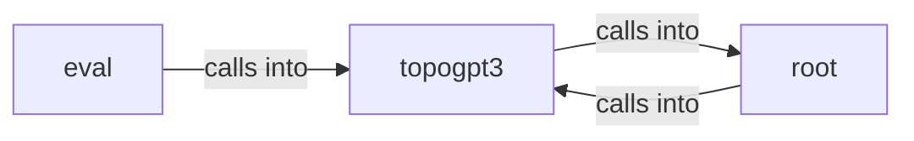

# topogpt3: model

topogpt3: model groups 15 files (py) around TopoGPT2Config, __post_init__, setup_logger, set_seed, QuaternionOps. Diagnostico estatico de un checkpoint TopoGPT3 congelado.

## eval (1.1)

eval groups 1 files (py) around phase_discretization, synthetic_winding, static_kappa, context_length_diagnostic, main. Diagnostico estatico de un checkpoint TopoGPT3 congelado.

## root (1.2)

root groups 1 files (py) around LLMBackend, generate, name, GroqBackend, __init__. Synthetic Dataset Generator for TopoGPT2.

## topogpt3 (1.3)

topogpt3 groups 13 files (py) around TopoGPT2Config, __post_init__, setup_logger, set_seed, QuaternionOps. main: TopoGPT3 entry point.

**Files**:

- eval/diag_static.py
- synthetic_dataset.py
- topogpt3/__main__.py
- topogpt3/convert.py
- topogpt3/export_chat.py
- topogpt3/lora.py
- topogpt3/model.py
- topogpt3/rollout.py
- topogpt3/train.py
- topogpt3/train_distill.py
- topogpt3/train_dpo.py
- topogpt3/train_grpo.py
- topogpt3/train_lora.py
- topogpt3/train_ppo.py
- topogpt3/trainer_utils_topo.py
