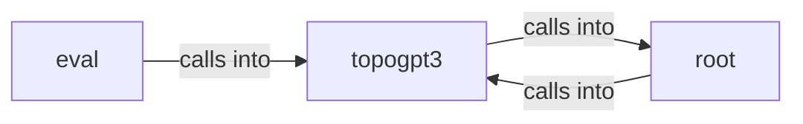

# topogpt3: model

topogpt3: model groups 8 files (py) around TopoGPT2Config, __post_init__, setup_logger, set_seed, QuaternionOps. Diagnostico estatico de un checkpoint TopoGPT3 congelado.

## eval (3.1)

eval groups 1 files (py) around phase_discretization, synthetic_winding, static_kappa, context_length_diagnostic, main. Diagnostico estatico de un checkpoint TopoGPT3 congelado.

## root (3.2)

root groups 1 files (py) around LLMBackend, generate, name, GroqBackend, __init__. Synthetic Dataset Generator for TopoGPT2.

## topogpt3 (3.3)

topogpt3 groups 6 files (py) around TopoGPT2Config, __post_init__, setup_logger, set_seed, QuaternionOps. OpenAI-compatible HTTP API server so TopoGPT3 can be used as a backend for coding...

**Files**:

- eval/diag_static.py
- synthetic_dataset.py
- topogpt3/api_server.py
- topogpt3/continuation.py
- topogpt3/export_chat.py
- topogpt3/inference_hrm.py
- topogpt3/model.py
- topogpt3/train.py
