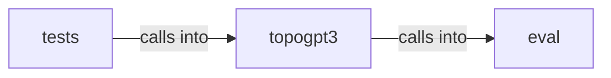

# topogpt3: sandbox

topogpt3: sandbox groups 7 files (py) around YaRNConfig, yarn_scale_inv_freq, apply_yarn_to_rope, pre_processing_chat, post_processing_chat. Sandbox for executing model-generated code during HumanEval evaluation.

## eval (4.1)

eval groups 2 files (py) around SandboxConfig, _names_imported, _blocked_dunder_access, _max_depth, d. Sandbox for executing model-generated code during HumanEval evaluation.

## tests (4.2)

tests groups 1 files (py) around _micro, test_chat_template_tools_think, test_yarn_changes_freqs_only, test_lora_zero_init_and_quaternion_targets, test_lora_save_load. Advanced-training tests: LoRA/RL/chat modules preserve quaternionic identity.

## topogpt3 (4.3)

topogpt3 groups 4 files (py) around YaRNConfig, yarn_scale_inv_freq, apply_yarn_to_rope, pre_processing_chat, post_processing_chat. Chat template + special tokens for TopoGPT3.

**Files**:

- eval/sandbox.py
- eval/sandbox_smoke.py
- tests/test_heritage.py
- topogpt3/chat.py
- topogpt3/eval_toolcall.py
- topogpt3/tools_agent.py
- topogpt3/yarn.py
