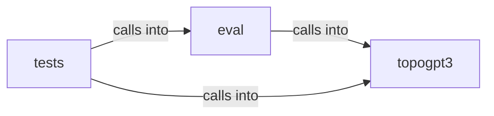

# topogpt3: tasks

topogpt3: tasks groups 10 files (py) around pre_processing_chat, post_processing_chat, _fmt_tool_defs, _tool_calls_text, apply_chat_template. Generic task eval: JSONL cases + safe verifiers.

## eval (3.1)

eval groups 1 files (py) around _extract_code, _extract_json, verify_tool_call, verify_json, verify_regex. Generic task eval: JSONL cases + safe verifiers.

## tests (3.2)

tests groups 3 files (py) around _gen, test_apt_chain_cases_full_pass, test_regex_verifier, test_tool_call_verifier_rejects_wrong_target, _call. Generic task eval tests (no model load).

## topogpt3 (3.3)

topogpt3 groups 6 files (py) around pre_processing_chat, post_processing_chat, _fmt_tool_defs, _tool_calls_text, apply_chat_template. Chat template + special tokens for TopoGPT3.

**Files**:

- eval/tasks.py
- tests/test_eval_tasks.py
- tests/test_fallback.py
- tests/test_heritage.py
- topogpt3/chat.py
- topogpt3/eval_toolcall.py
- topogpt3/fallback.py
- topogpt3/rewards.py
- topogpt3/tools_agent.py
- topogpt3/train_agent.py
